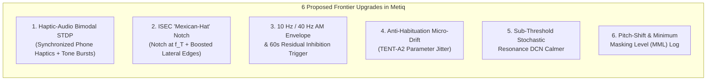

# Frontier Tinnitus Medical Research & Next-Generation Metiq Roadmap

This document synthesizes peer-reviewed neuroscience and pivotal clinical trials on subjective tinnitus (spanning foundational discoveries through **2024–2026 landmark trials**) and maps how **Metiq — Tinnitus Edition** aligns with—and can pioneer—features never before implemented in an open-source smartphone application.

---

## Part 1: Landmark Medical Research & Clinical Trials (With Direct Citations)

### 1. Targeted Bimodal Auditory-Somatosensory Neuromodulation & Spike-Timing-Dependent Plasticity (STDP)
- **Dr. Susan Shore's Pivotal Trial (*JAMA Network Open*, 2023):**
  - **Paper:** Jones, G. R., Martel, D. T., Riffle, T. L., Errickson, J., Souter, J. R., Basura, G. J., Stucken, E., Schacht, J., & Shore, S. E. (2023). *Reversing Synchronized Brain Circuits Using Targeted Auditory-Somatosensory Stimulation to Treat Phantom Percepts: A Randomized Clinical Trial*. **JAMA Network Open**, 6(6), e2315914.
  - **Direct Links:** [DOI: 10.1001/jamanetworkopen.2023.15914](https://doi.org/10.1001/jamanetworkopen.2023.15914) | [PubMed: 37266939](https://pubmed.ncbi.nlm.nih.gov/37266939/)
  - **Key Finding:** Subjective and somatic tinnitus originate from hyperactive, hypersynchronized **fusiform cells in the Dorsal Cochlear Nucleus (DCN)** of the brainstem. Crucially, DCN fusiform cells are **multisensory**: they integrate auditory nerve inputs with somatosensory (touch, vibration, proprioception) inputs from the head, jaw, neck, and skin. By pairing tinnitus-matched sound bursts with somatosensory pulses separated by a strict millisecond interval ($\Delta t \approx -5\text{ ms}$ to $-12\text{ ms}$), Shore's team induced **Long-Term Depression (LTD)** via **Spike-Timing-Dependent Plasticity (STDP)**—physically weakening the hyperactive synapses and producing clinically and statistically significant reductions in tinnitus loudness and Tinnitus Functional Index (TFI) scores.

### 2. Multi-Site Bimodal Neuromodulation & Anti-Habituation Parameter Switching (TENT-A2 & TENT-A3 Trials)
- **TENT-A3 Pivotal Trial (*Nature Communications*, 2024) & Real-World Evidence (*American Journal of Audiology*, 2026):**
  - **Paper (TENT-A3):** Boedts, M., Buechner, A., Khoo, S. G., Gjini, K., et al. (2024). *Combining sound with tongue stimulation for the treatment of tinnitus: a multi-site single-arm controlled pivotal trial*. **Nature Communications**, 15, 6806.
  - **Direct Links:** [DOI: 10.1038/s41467-024-50473-z](https://doi.org/10.1038/s41467-024-50473-z) | [PubMed: 39160146](https://pubmed.ncbi.nlm.nih.gov/39160146/)
  - **Paper (TENT-A2):** Conlon, B., Hamilton, C., Meade, E., Leong, S. L., O'Connor, C., Langguth, B., Vanneste, S., Hall, D. A., Hughes, S., & Lim, H. H. (2022). *Different bimodal neuromodulation settings reduce tinnitus symptoms in a large randomized trial*. **Scientific Reports**, 12, 10845.
  - **Direct Links:** [DOI: 10.1038/s41598-022-13875-x](https://doi.org/10.1038/s41598-022-13875-x) | [PubMed: 35773272](https://pubmed.ncbi.nlm.nih.gov/35773272/)
  - **Key Finding:**
    1. In **TENT-A3**, bimodal stimulation (sound + tactile/somatosensory stimulation) was proven clinically superior to sound-only therapy in patients with moderate-to-severe tinnitus.
    2. In **TENT-A2**, researchers discovered that **changing stimulation parameters over time** (varying tone burst timing, frequency offsets, and background harmonic envelopes) prevented **neural habituation** and drove continued neuroplastic symptom reduction long after static sound therapy would have plateaued.

### 3. Increased Spectral Energy Contrast in Tailor-Made Notched Sound Therapy (ISEC-TMNM)
- **Foundational & Enhanced Lateral Inhibition Studies (*PNAS*, 2010 & *PLOS ONE*, 2015):**
  - **Paper 1:** Okamoto, H., Stracke, H., Stoll, W., & Pantev, C. (2010). *Listening to tailor-made notched music reduces tinnitus loudness and tinnitus-related auditory cortex activity*. **Proceedings of the National Academy of Sciences (PNAS)**, 107(3), 1207–1210.
    - **Direct Links:** [DOI: 10.1073/pnas.0911268107](https://doi.org/10.1073/pnas.0911268107) | [PubMed: 20080545](https://pubmed.ncbi.nlm.nih.gov/20080545/)
  - **Paper 2:** Stein, A., Engell, A., Lau, P., Wunderlich, R., Junghoefer, M., Wollbrink, A., Bruchmann, M., Rudack, C., & Pantev, C. (2015). *Enhancing Inhibition-Induced Plasticity in Tinnitus – Spectral Energy Contrasts in Tailor-Made Notched Music Matter*. **PLOS ONE**, 10(5), e0126494.
    - **Direct Links:** [DOI: 10.1371/journal.pone.0126494](https://doi.org/10.1371/journal.pone.0126494) | [PubMed: 25951609](https://pubmed.ncbi.nlm.nih.gov/25951609/)
  - **Key Finding:** Removing acoustic energy at the patient's tinnitus frequency ($f_T$) suppresses hyperactive auditory cortex neurons via **lateral inhibition** from neighboring frequency bands. Stein, Okamoto & Pantev demonstrated via Magnetoencephalography (MEG) that **amplifying the spectral edges ("shoulders") immediately adjacent to the notch** (creating a "Mexican-hat" spectral profile) significantly strengthens inhibition-induced cortical plasticity compared to a simple flat notch.

### 4. 10 Hz & 40 Hz Amplitude-Modulated (AM) Tones for Residual Inhibition (RI)
- **University of Regensburg & University of Zurich Residual Inhibition Trials (*Frontiers in Aging Neuroscience*, 2017 & *Trends in Hearing*, 2019):**
  - **Paper 1:** Neff, P., Michels, J., Meyer, M., Schecklmann, M., Langguth, B., & Schlee, W. (2017). *10 Hz Amplitude Modulated Sounds Induce Short-Term Tinnitus Suppression*. **Frontiers in Aging Neuroscience**, 9, 130.
    - **Direct Links:** [DOI: 10.3389/fnagi.2017.00130](https://doi.org/10.3389/fnagi.2017.00130) | [PubMed: 28579955](https://pubmed.ncbi.nlm.nih.gov/28579955/)
  - **Paper 2:** Neff, P., Zielonka, L., Meyer, M., Langguth, B., Schecklmann, M., & Schlee, W. (2019). *Comparison of Amplitude Modulated Sounds and Pure Tones at the Tinnitus Frequency: Residual Tinnitus Suppression and Stimulus Evaluation*. **Trends in Hearing**, 23, 2331216519833841.
    - **Direct Links:** [DOI: 10.1177/2331216519833841](https://doi.org/10.1177/2331216519833841) | [PubMed: 30871419](https://pubmed.ncbi.nlm.nih.gov/30871419/)
  - **Key Finding:** **Sinusoidal Amplitude-Modulated (SAM) tones** centered at the matched tinnitus frequency ($f_T$) and modulated at **$10\text{ Hz}$ (Alpha band)** or **$40\text{ Hz}$ (Gamma band)** produce **stronger and longer-lasting Residual Inhibition** (temporary silence/suppression of tinnitus *after* the stimulus stops) than unmodulated pure tones, while being tolerated much better by patients.

### 5. Acoustic Coordinated Reset (CR) Neuromodulation
- **Desynchronizing Pathological Auditory Synchrony (*Restorative Neurology and Neuroscience*, 2012):**
  - **Paper:** Tass, P. A., Adamchic, I., Freund, H. J., von Stackelberg, T., & Hauptmann, C. (2012). *Counteracting tinnitus by acoustic coordinated reset neuromodulation*. **Restorative Neurology and Neuroscience**, 30(2), 137–159.
  - **Direct Links:** [DOI: 10.3233/RNN-2012-110218](https://doi.org/10.3233/RNN-2012-110218) | [PubMed: 22414611](https://pubmed.ncbi.nlm.nih.gov/22414611/)
  - **Key Finding:** Delivering short, randomized sequences of four tones spaced around $f_T$ ($0.766 f_T, 0.900 f_T, 1.100 f_T, 1.305 f_T$) in a 3-cycles-ON / 2-cycles-OFF pattern disrupts pathological neuronal synchrony in the primary auditory cortex, causing the network to "unlearn" the hyper-synchronized tinnitus state and shifting pathological EEG rhythms back toward normal baselines.

### 6. Stochastic Resonance & Central Gain Down-Regulation
- **University of Erlangen-Nuremberg Computational & Clinical Model (*Frontiers in Neuroscience*, 2016):**
  - **Paper:** Krauss, P., Tziridis, K., Metzner, C., Schilling, A., Hoppe, U., & Schulze, H. (2016). *Stochastic Resonance Controlled Upregulation of Internal Noise after Hearing Loss as a Putative Cause of Tinnitus-Related Neuronal Hyperactivity*. **Frontiers in Neuroscience**, 10, 597.
  - **Direct Links:** [DOI: 10.3389/fnins.2016.00597](https://doi.org/10.3389/fnins.2016.00597) | [PubMed: 28082855](https://pubmed.ncbi.nlm.nih.gov/28082855/)
  - **Key Finding:** When cochlear synaptopathy or subtle high-frequency hearing loss reduces auditory nerve input, the brainstem injects **internal neural noise** via **Stochastic Resonance (SR)** to lift weak signals above threshold—and that excess internal noise is perceived as tinnitus. Providing external, **near-threshold band-limited stochastic noise** around the affected frequency range satisfies the DCN's autocorrelation detector, allowing the brain to turn **down** its internal neural noise.

---

## Part 2: Frontier Features We Can Add to Metiq (Never Seen Before in an Open-Source App)

Currently, **Metiq — Tinnitus Edition** already implements:
- Logarithmic FM Pitch Matching (`100 Hz – 16,000 Hz`) with $\pm 1\text{ Hz} / \pm 10\text{ Hz}$ fine nudges and $\div 2 / \times 2$ Octave Confusion checks.
- Pure Tone & Narrowband Band-Pass Hiss with variable $Q$ and constant-power L/R Ear Balance.
- 4 base modes: **Matched Masking**, **Phase Cancel**, **Notch Therapy**, and **CR Neuromodulation**.

Based on the medical breakthroughs above, we can elevate Metiq into a **first-of-its-kind frontier acoustic & bimodal research tool** with **6 pioneering upgrades**:

### Feature 1: Smartphone Haptic-Audio Bimodal STDP Mode *(Inspired by Shore et al., 2023 & TENT-A3, 2024)*
- **What Makes It Never-Seen-Before:** Hardware bimodal devices (*Auricle*, *Lenire*) cost \$3,000–\$4,000 and require proprietary stimulators. However, every Android phone has a precision **Haptic Actuator (`Vibrator` / `VibrationEffect`)**, and holding the phone against the **jaw/cheekbone (trigeminal nerve V2/V3)**, **mastoid/neck (C2 dorsal root)**, or **fingertips** activates somatosensory pathways that project to the brainstem.
- **How It Works in Metiq:**
  - When **Bimodal Haptic STDP** is toggled on in the Tinnitus sheet, `AudioEngine` fires brief $20\text{ ms}$ tinnitus-matched tone bursts paired with crisp micro-haptic pulses at a user-adjustable **STDP Timing Offset** ($\Delta t \in [-15\text{ ms}, +15\text{ ms}]$, defaulting to the clinical $-8\text{ ms}$ auditory-somatosensory window, automatically compensated for `AudioTrack` output latency).

### Feature 2: ISEC "Mexican-Hat" Spectral Contrast Notch Filter *(Stein, Okamoto & Pantev, 2015)*
- **What Makes It Never-Seen-Before:** Existing notch apps only apply a simple band-stop cut. None implement **Increased Spectral Energy Contrast (ISEC)**.
- **How It Works in Metiq:**
  - Upgrades `Notch Therapy` in `AudioEngine.kt` from a single biquad band-stop filter to a **3-Biquad Cascade**:
    1. A deep central **Band-Stop Notch** at $f_T$.
    2. A **Lower Flanking Peak EQ Boost** ($+6$ to $+12\text{ dB}$) at $f_{\text{low}} = f_T \cdot 2^{-\text{bw}}$.
    3. An **Upper Flanking Peak EQ Boost** ($+6$ to $+12\text{ dB}$) at $f_{\text{high}} = f_T \cdot 2^{+\text{bw}}$.
  - Adds a **"Lateral Edge Boost" slider** so the neighboring frequencies actively drive lateral inhibition to quiet the tinnitus neurons.

### Feature 3: 10 Hz (Alpha) & 40 Hz (Gamma) Amplitude-Modulation (AM) + "Residual Inhibition (RI) Pulse Session" *(Neff et al., 2017, 2019)*
- **What Makes It Never-Seen-Before:** Combines exact pitch matching with clinical $10\text{ Hz}$ Alpha and $40\text{ Hz}$ Gamma sinusoidal envelope modulation ($100\%$ modulation depth) plus a dedicated **1-Tap "60s Residual Inhibition Trigger"**.
- **How It Works in Metiq:**
  - Adds an **AM Pulse Rate** selector (`Steady`, `10 Hz Alpha AM`, `40 Hz Gamma AM`) that modulates any matched tone or narrowband hiss:
    $$A(t) = \frac{1 - \cos(2\pi f_{\text{AM}} t)}{2}$$
  - Adds a **"60s RI Trigger" button**: plays the $10\text{ Hz}$ AM matched stimulus for 60 seconds, then smoothly fades to complete silence so you can immediately experience the post-stimulus **Residual Inhibition (quiet window)**.

### Feature 4: Anti-Habituation Micro-Drift *(Conlon et al., TENT-A2 Trial, 2022)*
- **What Makes It Never-Seen-Before:** Prevents the auditory cortex from adapting to static sound loops over multi-week use.
- **How It Works in Metiq:**
  - Adds an **Anti-Habituation Drift** toggle that introduces a slow, imperceptible $\pm 2.5\%$ random walk in modulation rate, CR burst timing, and harmonic spacing so the brain's neuroplasticity pathways stay actively engaged.

### Feature 5: Stochastic Resonance (SR) Sub-Threshold DCN Calmer *(Krauss & Schilling et al., 2016)*
- **What Makes It Never-Seen-Before:** Instead of masking tinnitus by playing sound *louder* than the ringing, this mode uses **Stochastic Resonance**—generating a specialized, ultra-low-amplitude octave-band noise bed right at the hearing threshold around $f_T$ so the brainstem down-regulates its own internal neural gain.

### Feature 6: Tinnitus Pitch-Shift & Minimum Masking Level (MML) History Log *(Tass et al., 2012)*
- **What Makes It Never-Seen-Before:** Clinical trials show that as neuromodulation works, your tinnitus pitch ($f_T$) and Minimum Masking Level (MML) shift downward over weeks.
- **How It Works in Metiq:**
  - Adds a lightweight, 100% offline **Pitch & Relief History Log** inside the Tinnitus sheet that records snapshots of your matched Hz, volume (MML), and a 1–10 relief rating so you can visually track your progress over time.
